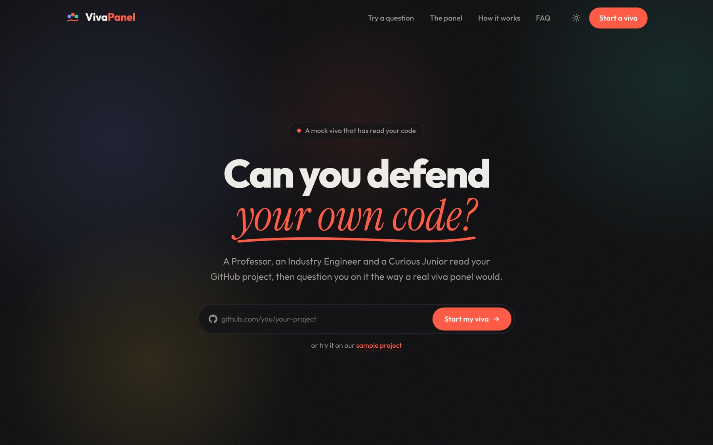
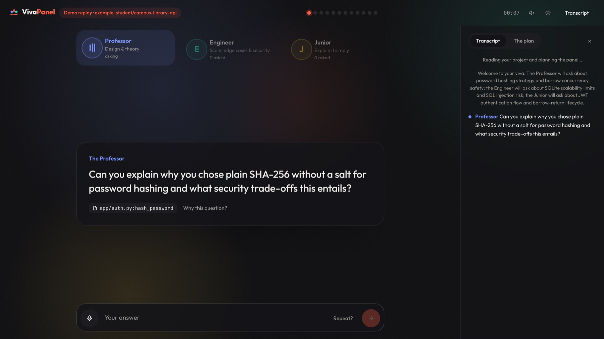
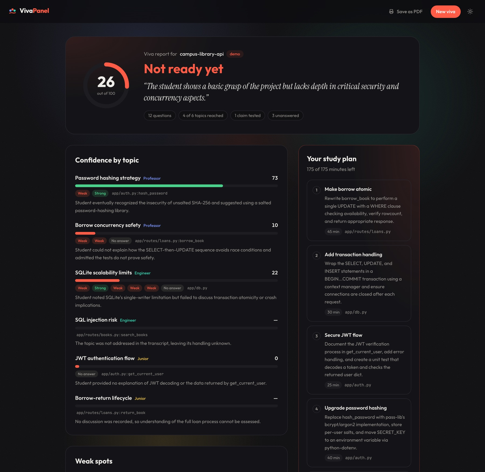
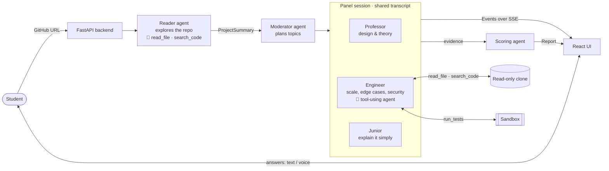

<div align="center">

# 🎓 Viva Panel

**Can you defend your own code?**

A multi-agent AI examiner panel that reads your GitHub project and questions you on it
the way a real viva panel would, then writes an evidence-backed report and study plan.


[](https://github.com/goyalnishtha841/vivapanel/actions/workflows/ci.yml)

**[▶ Try it live: viva-panel.onrender.com](https://viva-panel.onrender.com)**



</div>

---

## Contents

- [What Viva Panel does](#what-viva-panel-does)
- [Project status](#project-status)
- [Screenshots](#screenshots)
- [How it works](#how-it-works)
- [Measured results](#measured-results)
- [Tech stack](#tech-stack)
- [Repository layout](#repository-layout)
- [Getting started](#getting-started)
- [Configuration](#configuration)
- [API overview](#api-overview)
- [Tests and evals](#tests-and-evals)
- [Limitations](#limitations)
- [Roadmap](#roadmap)
- [Team](#team)

---

## What Viva Panel does

Students increasingly ship projects they can't explain: code generated by AI, copied from
tutorials, or written by a teammate. A real viva catches that, but faculty time is scarce and
mock vivas are rare. Viva Panel gives every student a rehearsal with examiners that have
actually read their code:

1. **Paste a GitHub link.** The backend clones the repo, and a reader agent explores it (opening
   files, searching for where README claims live) to pick the files that matter and summarise the project. On a team project you say which contributor you are, and the git
   history decides which files are yours.
2. **Meet the panel.** A moderator plans the topics, and three examiners take turns:
   - 🎓 **The Professor** asks about design and theory: *why this approach, and what are the trade-offs?*
   - 🔧 **The Industry Engineer** asks about scale, edge cases and security, and checks your claims against the code.
   - 🙋 **The Curious Junior** asks you to explain things simply, which is where copied code shows.
3. **Answer by typing or speaking.** Every answer is judged against the real code (strong,
   partial, weak or no answer). Weak answers get follow-ups, and examiners can challenge each
   other's verdicts.
4. **Get your report.** A score per topic, your weak answers quoted back with the file they
   concern, what the tests proved, and a time-boxed study plan.
5. **Retake your weak topics.** After studying, a shorter viva goes over only what you got wrong,
   with new questions, and the report shows how each topic changed.

Every claim in the report points at a real transcript turn or repo file. Code checks those
references and copies the quotes itself, so the model can't invent evidence.

### Key features

| | |
|---|---|
| 🧑‍⚖️ **Three distinct examiners** | Different lenses (theory, production, plain language) and tones, sharing one transcript so they notice contradictions |
| 🗺️ **Agentic repo reader** | Before planning, an agent explores the repo (opens files, searches for where README claims live) and picks the files worth examining; each step shows live. Code validates every path and function, and rule-based ranking is the fallback |
| 🧭 **Planned, not random** | A moderator assigns 2 non-overlapping topics per examiner, each anchored to a real file |
| 🔍 **Tool-using Engineer** | Calls `read_file` and `search_code` on your repo in a function-calling loop: if you say "I close connections in a teardown hook", it searches and finds out |
| 🧪 **Claims get tested** | "My tests cover that" → the Engineer picks the tests, runs them and judges whether they really exercise the claim |
| ⚔️ **Cross-examination** | After a verdict, a colleague may disagree or push the point into their own lane |
| 🛡️ **Guardrails in code** | Empty, "I don't know", off-topic, pasted-code and prompt-injection answers are classified and capped by code, not left to the model |
| 👥 **Team-project mode** | Pick which contributor you are; the git history shows which files you wrote, and code guarantees at least half the topics are on your own code. The report marks "your code" vs "teammate's code" |
| 🤝 **Hiring mode** | A recruiter creates an interview link with the role and skills to probe. The candidate sees exactly what will be shared, then takes the same viva; questions are weighted to the role. The recruiter's private page has per-skill scores, flags, test evidence, how answers were given, and the full transcript, presented as one signal for a person to review |
| 🔁 **Re-viva** | "Retake my weak topics" builds a short viva from your lowest-scoring topics (same examiner and file, new questions; code rejects last time's) and the report shows progress per topic |
| 📄 **Evidence-backed report** | Code computes every score and copies every quote; the model writes the study plan and recruiter summary, and every reference is validated |
| 🛟 **Never stalls on limits** | Cross-provider fallback (Groq big → Groq small → Gemini flash → flash-lite) with a 45 s timeout per call |
| 🎙️ **Voice** | Questions are read aloud and answers can be spoken (browser speech APIs) |
| 🧾 **Code beside the question** | The real file opens next to every question with the function in question lit up, and it follows the Engineer live as it reads files and jumps to the lines its searches match |
| ⚡ **Live streaming** | Agent turns, reasoning and tool activity stream to the UI over server-sent events |

---

## Project status

*As of 20 October 2026.*

| Area | State |
|---|---|
| End-to-end app (repo link → viva → report) | ✅ **Deployed** at [viva-panel.onrender.com](https://viva-panel.onrender.com); a full 12-question viva verified on the live URL |
| Agents (moderator, 3 examiners, scoring) | ✅ Live on Groq with a Gemini backup; edge-case eval 7/7 |
| Real GitHub repos | ✅ Clone, key-file selection, summary and questions verified live (e.g. `pallets/markupsafe`); 5-repo study in progress |
| Token use | ✅ ~53k input tokens per session, cut 35% and measured |
| Tests and CI | ✅ 120 tests (unit, panel rules, retake, team mode, API), lint, offline evals, frontend build and Docker smoke test on every push (GitHub Actions) |
| Test sandbox for real repos | ✅ The student's pytest suite runs in a throwaway Docker container or E2B microVM (no network while testing, resource and time limits). Verified on `pallets/markupsafe`. On Render it needs an `E2B_API_KEY` |
| Voice | ✅ Browser speech in Chrome; not yet tested on every browser |

---

## Screenshots

| The panel on stage | The report |
|---|---|
|  |  |

The examiner who is asking is lit, and the question cites the exact function it's about. The
report scores each topic from the verdicts, quotes weak answers and ends with a study plan.

---

## How it works



**The model makes the judgements; code makes the guarantees.**

| The LLM decides | Code guarantees |
|---|---|
| Which topics to probe and why | Every file reference exists in the repo |
| The question and its follow-ups | Limits: 12 questions per viva, 2 follow-ups per topic, one question at a time, rewritten if too long or repeated |
| The verdict on each answer | Edge-case verdicts: empty and "I don't know" are always *no answer*; an injection attempt never scores above *weak* |
| Whether to challenge a colleague | At most 2 challenges per viva, on the same file |
| Which tools to call and which tests to run | Tool budgets; the tests always run, and the outcome is corrected if it contradicts the real result |
| The study plan and summary | Scores, quotes and readiness are computed, never generated |

**Scoring:** strong 1.0 · partial 0.55 · weak 0.2 · no answer 0, with later answers weighted
more (recovering after a follow-up counts). A test that contradicts the student's claim costs
15 points. Readiness: ≥ 80 ready · ≥ 60 almost ready · ≥ 40 needs work · below 40 not ready.

Full design, diagrams and trade-offs: **[docs/architecture.md](docs/architecture.md)**.

---

## Measured results

| What | Result | Evidence |
|---|---|---|
| Edge-case handling, live | **7 / 7** (clarify, "idk", one word, empty, injection, off-topic, pasted code) | [day4-eval.md](docs/evidence/day4-eval.md), [token-optimisation.md](docs/evidence/token-optimisation.md) |
| Question quality, live | Avg 20 words, max 35, 0% multi-part questions, 0 invalid file references | [token-optimisation.md](docs/evidence/token-optimisation.md) |
| Tokens per 12-question session | **81k → 53k input (−35%)**; a live run used 44k in + 4k out | [token-optimisation.md](docs/evidence/token-optimisation.md) |
| Provider failover, live | Groq hit its limit mid-session and Gemini took over, including the Engineer's tool loop, without the session stopping | [live-edge-eval-gemini-fallback.json](docs/evidence/live-edge-eval-gemini-fallback.json) |
| Tool-using Engineer | Searched the repo and caught a student falsely claiming a teardown hook closes every connection | [agentic-engineer.md](docs/evidence/agentic-engineer.md) |
| Full viva on the deployed URL | 12 questions + report in about 2.5 minutes | — |

---

## Tech stack

| Layer | Choice | Why |
|---|---|---|
| Agents | Python, Pydantic structured outputs, a hand-written function-calling loop | Strict JSON schemas make every decision machine-checkable; no framework hides the loop |
| LLMs | Groq `gpt-oss-120b` / `gpt-oss-20b`, Gemini flash as backup, Claude supported | Sub-second calls and a free tier; a second provider so a demo never stops; one setting to switch |
| Backend | FastAPI, server-sent events | Streams agent turns as they happen; SSE is one-way, which is all the panel needs, and reconnects on its own |
| Storage | SQLite (WAL) | One file, zero setup; sessions and an ordered event log are all we store |
| Frontend | React 18, Vite, Tailwind, framer-motion | Fast iteration; the stage, scorecard and report are all components |
| Deploy | One Docker image on Render | FastAPI also serves the built app, so there's one URL and no CORS |

---

## Repository layout

```
viva-panel/
├── agents/                 # the AI panel
│   ├── moderator.py        #   plans topics, hands over the floor
│   ├── examiner.py         #   Professor / Engineer / Junior: questions, verdicts, follow-ups
│   ├── panel.py            #   turn-taking, challenges, edge-case enforcement
│   ├── scoring.py          #   scores in code + narrative from the model
│   ├── llm.py              #   Groq / Gemini / Claude calls, fallback chain, tool loop
│   ├── guardrails.py       #   answer classification, injection detection
│   ├── schemas.py          #   shared Pydantic models (the contract)
│   ├── prompts/            #   role prompts
│   └── eval.py, quality.py, profile_tokens.py
├── backend/app/            # FastAPI API, GitHub ingestion, sessions, SSE
├── frontend/               # React app: landing, live panel, report
├── tests/                  # unit, panel-rule and API tests (pytest)
├── docs/                   # architecture, API contract, jury Q&A, deploy, evidence
├── Dockerfile, render.yaml # one-container deploy
└── requirements.txt
```

---

## Getting started

### Option 1: Docker (closest to production)

```bash
cp .env.example .env            # add GROQ_API_KEY, and GEMINI_API_KEY as a backup
docker build -t viva-panel .
docker run -p 8000:8000 --env-file .env viva-panel
```

Then open http://localhost:8000.

### Option 2: run the parts separately (for development)

```bash
python3 -m venv .venv && .venv/bin/pip install -r requirements.txt
cp .env.example .env
.venv/bin/uvicorn backend.app.main:app --port 8000
```

In a second terminal:

```bash
cd frontend && npm install && VITE_API_URL=http://127.0.0.1:8000 npm run dev
```

The UI runs on http://localhost:5190. Without `VITE_API_URL` it runs in **demo mode** and replays
a recorded live session, with no backend or keys needed.

### Agents only (terminal)

```bash
.venv/bin/python -m agents.cli                   # full panel against the sample project
.venv/bin/python -m agents.cli --only professor  # one examiner
VIVA_OFFLINE=1 .venv/bin/python -m agents.cli    # scripted, no API calls
```

To deploy your own copy, see **[docs/deploy.md](docs/deploy.md)**.

---

## Configuration

All settings come from `.env` (see [.env.example](.env.example)).

| Variable | Default | What |
|---|---|---|
| `VIVA_PROVIDER` | `anthropic` | Primary LLM provider: `groq`, `gemini` or `anthropic` |
| `GROQ_API_KEY` | — | Groq key (free tier: 8k tokens/min and 200k/day per model) |
| `GEMINI_API_KEY` | — | Turns on the Gemini backup automatically |
| `ANTHROPIC_API_KEY` | — | For Claude |
| `GITHUB_TOKEN` | — | Optional; raises GitHub's repo-check limit from 60 to 5,000 an hour |
| `E2B_API_KEY` | — | Hosted test sandbox for real repos (Render can't run Docker) |
| `VIVA_SANDBOX` | `auto` | `auto` (E2B if keyed, else Docker if running), `docker`, `e2b` or `off` |
| `VIVA_DAILY_SESSIONS` | `40` | New vivas allowed per rolling 24 h on a public deploy (0 = no cap) |
| `VIVA_OFFLINE` | `0` | `1` runs scripted agents with no model calls |
| `VIVA_DEBUG` | `0` | `1` prints latency and tokens for every model call |

---

## API overview

| Method | Path | What |
|---|---|---|
| `POST` | `/session` | Start a viva: `{"repo_url": "https://github.com/owner/name"}` → `{"session_id"}`; or retake: `{"retake_of": "<id>"}`; team project: add `"student": "<github login>"`; hiring: add `"invite": "<token>"` |
| `GET` | `/stream/{id}` | Server-sent events, one per agent turn (speaker, message, reasoning, file, tool) |
| `POST` | `/answer` | `{"session_id", "answer"}` |
| `GET` | `/report/{id}` | The report (202 while it's being scored) |
| `GET` | `/session/{id}` | Status, question limit, and the session it retakes |
| `GET` | `/contributors?repo_url=` | Human contributors of a repo, for "which one are you?" |
| `GET` | `/code/{id}?path=` | One repo file for the code viewer (listed paths only) |
| `POST` | `/invites` | Hiring: `{title, company, focus[]}` → candidate link token + private results key |
| `GET` | `/invites/{token}` | What the candidate sees before starting (role, already used?) |
| `GET` | `/screening/{token}?key=` | The recruiter's results: status, then the screening report with transcript |
| `GET` | `/health` | Liveness and the active model |

Full contract, including the event and report shapes: [docs/api-contract.md](docs/api-contract.md).

---

## Tests and evals

**Tests** pin down everything the architecture says code guarantees. They run offline in about a second:

```bash
pip install -r requirements-dev.txt
pytest -q                      # 120 tests
ruff check agents backend tests
```

| Suite | What it proves |
|---|---|
| `test_panel_rules.py` | Swaps the LLM for one that **breaks every rule on purpose** (invented files, run-on questions, endless follow-ups and challenges, "strong" for everything, misread test results) and checks the panel still keeps every limit: 12 questions, 2 follow-ups, 2 challenges on the same file, 1 test run, real file references, enforced edge-case verdicts |
| `test_scoring.py` | Verdict weights, later answers weighing more, the contradiction penalty, readiness thresholds, and that invented turns and files in the model's narrative are dropped |
| `test_guardrails.py` | Answer classification (empty, "idk", clarify, injection, one word, long paste), file and function reference checks, question-quality checks |
| `test_llm_routing.py` | The fallback chain: per-minute limits move to the next model, daily caps are remembered, other errors aren't retried, strict schemas are closed |
| `test_repo_tools.py` | The Engineer's tools can't read outside the repo (`../`, absolute paths, symlinks); GitHub link parsing rejects anything else |
| `test_retake.py` | Retakes target the weakest topics with the same examiner and file, stay short, show progress, and reject last time's questions |
| `test_team_mode.py` | Git-history ownership on a real throwaway repo (emails, names, GitHub noreply addresses), and that at least half the planned topics land on the student's own files even when the model plans none there |
| `test_sandbox.py` | Reading pytest's output (pass, fail, collection error, timeout), only real test files can be targeted, a failed install never runs tests, backend choice |
| `test_reader.py` | The reader agent's picks are validated (no invented paths or functions, no tests or non-code, no duplicates), each step is narrated once, the student's files are always kept in team mode, and a broken agent falls back to one summary call |
| `test_hiring.py` | The full screening flow, single-use links, a wrong or missing key opens nothing, the candidate can't open the recruiter's report or retake, the role reaches the planner, skill scores are computed by code from the model's topic mapping, integrity counts |
| `test_api.py` | A full viva over HTTP, event ordering for stream resume, 400/404/409/422/429 responses, the daily cap |

We checked that the suite catches regressions: disabling the edge-case enforcement or the follow-up cap makes it fail.

**Evals** run whole sessions with scripted students:

```bash
.venv/bin/python -m agents.eval edge     # scripted edge-case student, checks every verdict
.venv/bin/python -m agents.eval mixed    # vague-then-specific student, full report
.venv/bin/python -m agents.eval large    # 3,000-file repo, prompt-size check
.venv/bin/python -m agents.quality runs/*.json    # question-quality metrics for any saved run
.venv/bin/python -m agents.profile_tokens         # tokens per session, no API calls
```

Add `VIVA_OFFLINE=1` to run without a key. Results and saved runs are in [docs/evidence/](docs/evidence/).

[CI](.github/workflows/ci.yml) runs lint, the tests, the offline evals, the frontend build and a Docker smoke test on every push to `main` and every pull request.

---

## Limitations

- **Test runs need a sandbox backend.** Locally Docker is used automatically; on Render the hosted
  sandbox needs an `E2B_API_KEY`. Without one, real repos are read and searched but not test-run.
- **Free-tier limits.** About 5 full sessions a day on Groq's free tier, plus the Gemini backup.
  The deploy caps new vivas per day so a public link can't drain them.
- **Scoring isn't calibrated against human examiners yet.** The weights are a reasoned first
  version.
- **The sandbox targets Python and pytest first.** Questions and code tools work on any language.
- **Rehearsed answers.** A student who memorises an AI-written explanation can do better than
  they should. Follow-ups on specific lines and the Junior's "explain it simply" make that hard,
  but not impossible.
- **Demo hosting.** Render's free plan sleeps after 15 minutes idle (the first visit then takes
  about a minute), and sessions don't survive a restart.

---

## Roadmap

**Done**

- [x] Moderator, three examiners and a scoring agent with structured outputs
- [x] Tool-using Engineer (`read_file`, `search_code`, `run_tests`)
- [x] Cross-examiner challenges and a shared transcript
- [x] Edge-case guardrails enforced in code
- [x] Evidence-validated report and study plan
- [x] FastAPI backend with GitHub ingestion and SSE streaming
- [x] React UI: landing, live panel with voice, report with PDF export
- [x] Token optimisation (−35%) and a Gemini backup with cross-provider fallback
- [x] Deployed as one Docker container
- [x] Test suite and CI on every push
- [x] Re-viva: retake the weakest topics with new questions and see progress per topic
- [x] Team-project mode: examine each member on the files they actually wrote (from git history)
- [x] Code viewer beside each question, following the Engineer's reads and searches live
- [x] Test sandbox for real repos: Docker locally, E2B when hosted; network cut before tests run
- [x] Agentic repo reader: an agent explores the repo to choose what to examine
- [x] Hiring mode: interview links, role-weighted questions, a private screening report with per-skill scores

**Next**

- [ ] Results from 5 real student repos
- [ ] Persistent storage (Postgres) and a teacher view for a whole batch
- [ ] Calibrate scores against real faculty viva marks
- [ ] More sandboxes: Node/Jest, Java/JUnit

---

## Team

Built for the **Ziro Agentic AI Hackathon 2026** by a three-person team.

<!-- Add each member's name and GitHub profile. -->

| Member | Area |
|---|---|
| Nishtha Goyal | AI and agents: moderator, examiners, scoring, guardrails, evals, LLM routing |
| | Backend and tools: API, ingestion, sandbox |
| | Frontend and voice: UI, streaming, report |

**License:** not yet chosen. All rights reserved by the authors until one is added.
