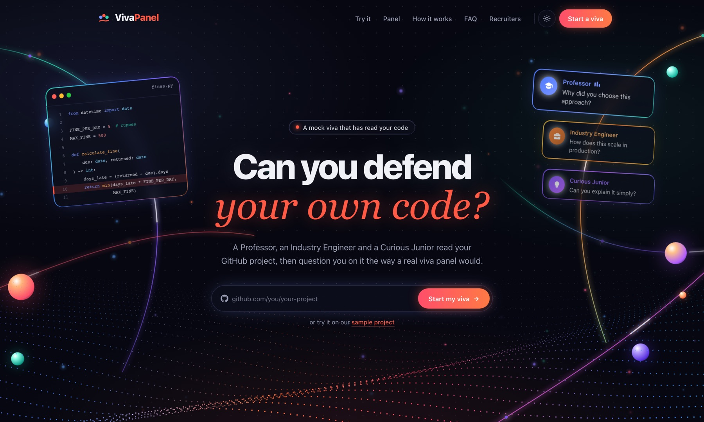
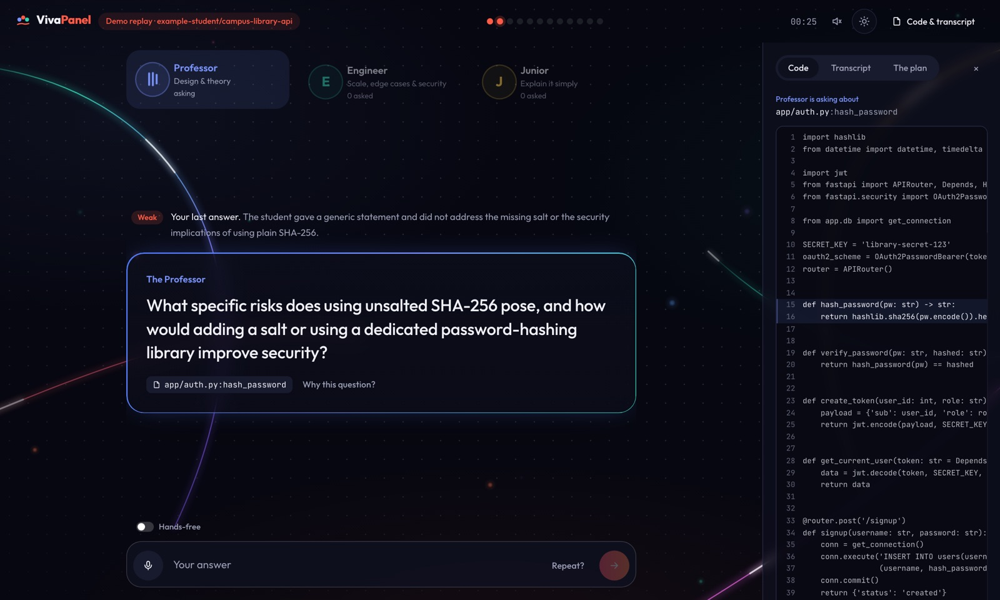
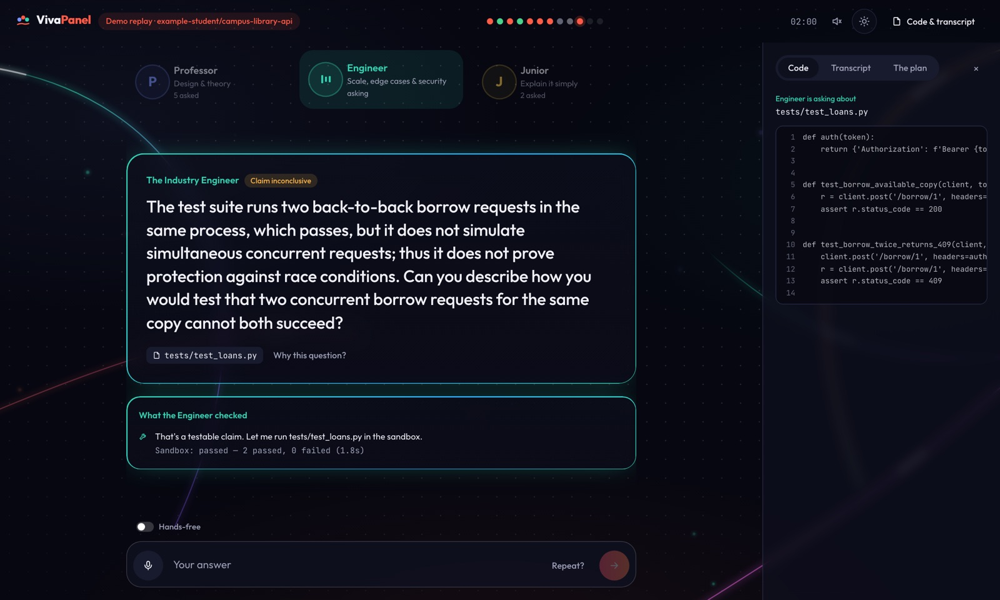
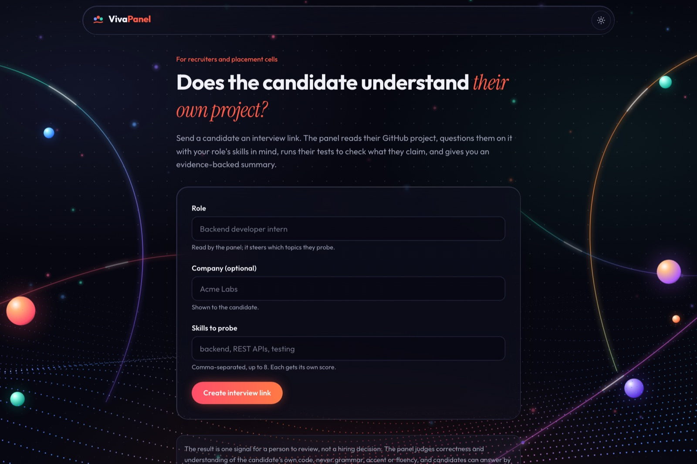
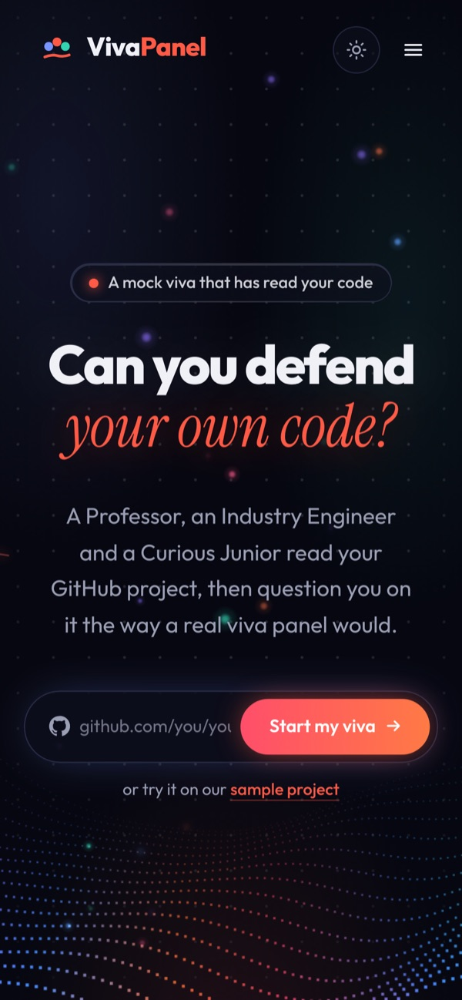
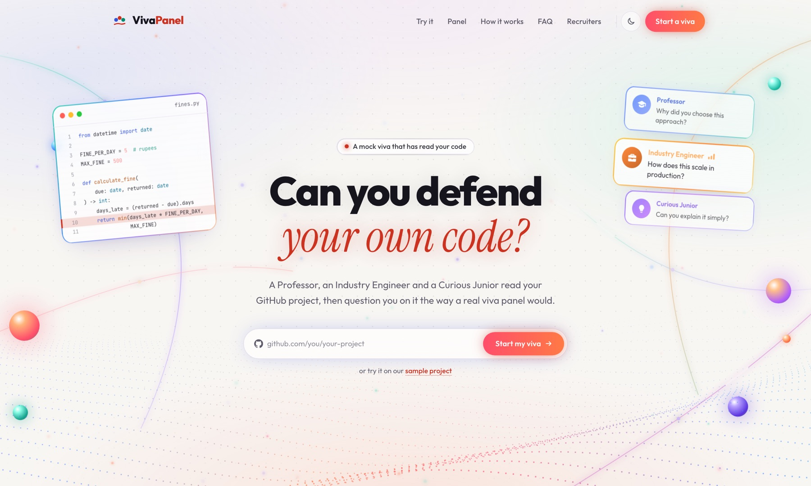
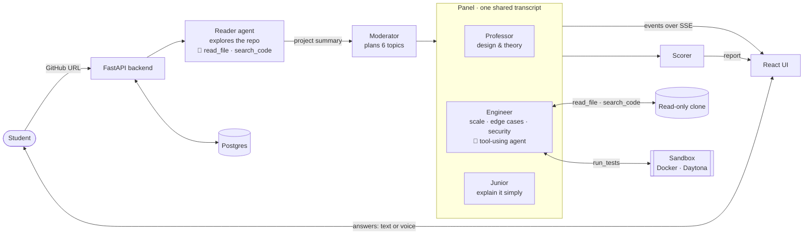

<div align="center">

# Viva Panel

**Can you defend your own code?**

A panel of AI examiners that reads your GitHub project, questions you on *your* code the way a real
viva panel would, checks what you claim by running your own tests, and writes an evidence-backed
report with a study plan.

[](https://github.com/goyalnishtha841/vivapanel/actions/workflows/ci.yml)


[](LICENSE)

### [▶ Try it live: viva-panel.onrender.com](https://viva-panel.onrender.com) · [▶ Watch the 2-minute demo](demo-video/out/demo.mp4)

<sub>Free hosting: if the site has been idle, the first load takes about a minute while it wakes up.
The demo is a real capture — a live viva run against a second repo
(<a href="https://github.com/goyalnishtha841/tradepilot">tradepilot</a>), not a mockup.</sub>

<br />



<sub>Built for the <b>Ziro Agentic AI Hackathon 2026</b> by team <b>Triple Threat AI</b>.</sub>

</div>

---

> **Reviewing this for hiring? The 30-second version.**
>
> - **What it is:** a multi-agent AI system (6 agents) that runs a live, typed-or-spoken oral exam on any public GitHub repo.
> - **What's hard about it:** agents that use tools in a loop (read files, search code, run tests in a sandbox),
>   kept reliable in a *live conversation* by enforcing every rule in code, not in prompts.
> - **Engineering:** FastAPI + React, streaming over Server-Sent Events, Postgres, isolated test sandboxes
>   (Docker / Daytona), automatic fallback across AI providers, 131 automated tests and CI on every push.
> - **Proof:** deployed and verified on real student projects; the numbers in this README link to evidence.

## Contents

[Take a look](#take-a-look) · [The problem](#the-problem) · [What it does](#what-viva-panel-does) ·
[Features](#features) · [What makes it different](#what-makes-it-different) · [How it works](#how-it-works) ·
[Results](#measured-results) · [Tech stack](#tech-stack-and-why) · [Safety and fairness](#safety-fairness-and-privacy) ·
[Run it locally](#run-it-locally) · [Testing](#testing) · [Repository layout](#repository-layout) ·
[Limitations and roadmap](#limitations-and-roadmap) · [Team](#team)

---

## Take a look

<table>
  <tr>
    <td width="50%"><br /><sub><b>Judged against your code.</b> A vague answer is rated <i>weak</i>, the Professor pushes with a sharper follow-up, and the exact function opens beside the question.</sub></td>
    <td width="50%"><br /><sub><b>Claims get tested.</b> "My tests cover double-borrowing" → the Engineer runs them in a sandbox: 2 passed, but they never send concurrent requests, so the claim is <i>inconclusive</i>.</sub></td>
  </tr>
  <tr>
    <td width="50%"><br /><sub><b>An evidence-backed report.</b> Scores per topic computed by code, weak answers quoted back with their file, and a time-boxed study plan.</sub></td>
    <td width="50%"><br /><sub><b>Hiring mode.</b> A recruiter sends an interview link; the candidate consents and takes the same viva; the recruiter gets a private, per-skill report.</sub></td>
  </tr>
</table>

<p align="center">
  
  &nbsp;&nbsp;
  
  <br />
  <sub>Works on phones, in dark and light themes.</sub>
</p>

---

## The problem

Students can now hand in projects they can't explain: code written by an AI tool, copied from a tutorial, or written
by a teammate. The one check that catches this is the **viva**, the oral exam at the end of a final-year project, where
examiners ask *"why did you do it this way?"*. But it happens once, with marks at stake, and with no way to practise:

- **Teachers don't have time** to run mock vivas for every student.
- **Friends and chatbots haven't read your code**, so they ask textbook questions, not *"why doesn't `borrow_book` lock the row?"*.
- **Recruiters face the same gap:** a CV links a GitHub project, but checking that the candidate understands it costs an engineer's hour.

| Existing option | Why it doesn't solve this |
|---|---|
| A real viva | Happens once, with marks at stake; depends on scarce teacher time |
| ChatGPT and other chatbots | Haven't read your repo, accept confident answers, can't run your tests, no panel, no evidence |
| AI mock-interview tools | Ask general or role-based questions, not questions about *your* project's code |
| Coding-practice sites | Test new puzzles, not understanding of code you already wrote |
| Plagiarism / AI-text detectors | Guess where code came from (often wrongly); can't tell if the student understands it |

**Our idea:** don't guess who wrote the code; ask the student to explain it. Understanding is what matters, and it
shows in answers. We automate the questioning, not the suspicion.

---

## What Viva Panel does

1. **Paste a GitHub link.** The server copies the repo, and a **reader agent** explores it (opening files, searching
   for where the README's claims live) to pick the files that matter. Each step is narrated live.
2. **Meet the panel.** A **moderator** plans 6 topics, 2 per examiner, each tied to a real file. Three examiners take turns:
   - 🎓 **The Professor**: design and theory. *Why this approach? What are the trade-offs?*
   - 🔧 **The Industry Engineer**: scale, edge cases and security. Reads your code and runs your tests to check claims.
   - 🙋 **The Curious Junior**: *can you explain it simply?* This is where copied code shows fastest.
3. **Answer by typing or speaking.** Each answer is judged against the real code (*strong*, *partial*, *weak* or *no answer*).
   Weak answers get sharper follow-ups, and examiners can challenge each other's verdicts.
4. **Get your report.** A score per topic, your weak answers quoted back with the file they were about, what your tests
   proved, and a study plan with time estimates. Save it as PDF or share the link.
5. **Retake your weak topics.** A shorter viva on only what you got wrong, with new questions, and the report shows
   how each topic improved (live run: *SQL injection 3 → 100*).

**Two more modes on the same panel:**

- 👥 **Team projects:** pick which contributor you are; git history decides which files you wrote, and the panel focuses on those.
- 🤝 **Hiring:** recruiters send an interview link with the role and skills to probe, and get a private screening report,
  presented as one signal for a person to review, never an automatic decision.

---

## Features

| | Feature | What it does |
|---|---|---|
| 🗺️ | **Agentic repo reader** | An agent opens and searches up to 4 files of its choosing, then picks what to examine. Code validates every path and function, so agents never see invented code |
| 🧭 | **Planned, not random** | The moderator assigns 2 non-overlapping topics per examiner, each anchored to a real file |
| 🧑‍⚖️ | **Three distinct examiners** | Different lenses and tones, one shared transcript, so they notice contradictions ("earlier you told the Professor…") |
| 🔍 | **Tool-using Engineer** | Calls `read_file` and `search_code` in a function-calling loop. Say "I close connections in a teardown hook" and it searches and finds out |
| 🧪 | **Claims verified by running tests** | Picks the right test file, runs it in a throwaway sandbox, reads it, and rules the claim *supported*, *contradicted* or *inconclusive*. Passing tests are not taken as proof |
| ⚔️ | **Cross-examination** | After a verdict, a colleague may push back ("I'd push back on that, Professor") or build on the point |
| 🛡️ | **Guardrails in code** | Empty answers, "I don't know", "repeat that", one-word replies, pasted code and prompt injection are classified and capped by code before the AI sees them |
| 📄 | **Evidence-backed report** | Code computes every score and copies every quote; the AI writes only the narrative and study plan, and its references are validated |
| 🔁 | **Retake (re-viva)** | Up to 3 weakest topics, same examiner and file, new questions (code rejects last time's), progress per topic |
| 👥 | **Team-project mode** | A file is yours if you made at least half its commits; at least half the topics land on your files; the report marks "your code" vs "teammate's code" |
| 🤝 | **Hiring mode** | Role-weighted questions, a consent screen, per-skill scores computed by code, flags with quotes, answer timing and pastes shown as context, full transcript. Single-use links; the recruiter key is stored only as a hash |
| 🧾 | **Code beside every question** | The real file opens with the function highlighted, and follows the Engineer live as it reads and searches |
| 🎙️ | **Voice and hands-free mode** | Each examiner has their own voice; answers can be spoken. Typing stays the main path, so accent never matters |
| 🛟 | **Never stalls on rate limits** | Every AI call falls back Groq 120b → Groq 20b → Gemini flash → flash-lite, with a 45 s timeout per call |
| ⚡ | **Live narration** | Every agent step streams to the browser over Server-Sent Events and resumes after a dropped connection |
| 💾 | **Built to run in public** | Postgres so reports survive restarts, per-visitor daily limits, automatic clean-up of abandoned repo copies, a `/health` page |

<details>
<summary><b>Every feature in detail: how each one is built</b></summary>

<br />

**Reader agent** (`backend/app/ingest.py`). One GitHub API call checks the repo is public and under 150 MB, then a
shallow clone. Rules rank up to 14 candidate files; the agent sees the README, the file tree and their function names,
opens or searches up to 4 files, and submits key files plus a project summary. Code checks every path and function
against the clone and cuts the snippets from the real files. If the agent fails, one plain call does the same job.

**Moderator** (`agents/moderator.py`). One structured-output call proposes topics; code drops invented files, wrong
examiners and duplicates, caps 2 per examiner and tops up anyone left empty. Turn order is plain round-robin code: an
LLM deciding who speaks next would add latency and cost with no benefit.

**Examiners** (`agents/examiner.py`, `agents/prompts/`). Each has its own role prompt plus shared rules: judge against
the code, one question at a time, at most 35 words, never grade grammar, accent or fluency. Each decision comes back as
a Pydantic schema (verdict, judgement, action, next question, any testable claim); code enforces the 2-follow-up limit
and rewrites questions that are too long, multi-part or repeated.

**Tool-using Engineer** (`agents/llm.py:agent_loop`, `agents/tools.py`). A hand-written function-calling loop: the
model picks a tool, code runs it and returns the result, the model decides again, then calls `submit`. Up to 3 tool
calls per answer. File tools refuse anything outside the repo (`../`, absolute paths, symlinks). If the loop breaks,
the Engineer judges without tools rather than stopping.

**Test sandbox** (`backend/app/sandbox.py`). Prepared in the background as soon as the repo is read: a throwaway
Docker container locally, a Daytona sandbox on the hosted site (E2B also supported). A copy of the repo goes in; a
Python 3.12 environment, pytest and the project's dependencies are installed; the network is cut (Docker) before any
test runs; each run has a 60 s limit; none of our keys are inside; the box is deleted afterwards. Code corrects the
verdict (an all-green run can never "contradict" a claim). At most 1 test run per viva.

**Guardrails** (`agents/guardrails.py`, `agents/panel.py:_enforce`). Every answer is classified before the model sees
it. "Repeat that" gets the question reworded, ungraded. After "I don't know", the next question gets easier. Empty and
"I don't know" are always *no answer*; an injection attempt never scores above *weak*, never triggers a test run, and
shows a visible note. Answers are wrapped in « » as data and clipped to 1,500 characters.

**Scoring** (`agents/scoring.py`). Per topic: strong 1.0, partial 0.55, weak 0.2, no answer 0, with later answers
weighted more (recovering after a follow-up counts); −15 if a test contradicted the student's claim. Overall = mean of
topics reached. Readiness: ≥ 80 ready, ≥ 60 almost ready, ≥ 40 needs work, below 40 not ready. The model may only cite
real transcript turns and files; code validates them and copies the quotes.

**Retake** (`agents/moderator.py:retake_plan`, `backend/app/runner.py`). Topics below 60, worst first, up to 3, same
examiner and file, 3 questions each. Examiners see last time's questions, and code rejects repeats.

**Team mode** (`backend/app/authorship.py`). The clone keeps commit history (not old file contents). Commits are matched
by email, name or GitHub's noreply address; a file is yours at ≥ 50% of its commits. Code guarantees at least half the
topics are on your files. History is deleted right after counting.

**Hiring mode** (`frontend/src/views/Hire.jsx`, `Invite.jsx`, `Screening.jsx`). The role reaches the moderator (topics
lean to the skills) and the scorer. The model only maps skills to topics; code computes each skill's score. The results
key is stored as a SHA-256 hash; the candidate's link can't open the recruiter report; links are single-use; screenings
can't be retaken. Every page says it's one signal for a person to review.

**Reliability** (`agents/llm.py`). One routing function wraps every call, including the tool loop: it reads the
rate-limit error, remembers which daily cap was hit, and moves to the next model. Token use per viva was cut from about
81k to 53k input tokens (−35%) with a cacheable project card, only the current topic's code per call, one-line
summaries of older turns and per-call output caps, measured with `python -m agents.profile_tokens`.

</details>

---

## What makes it different

- **It has read your code.** Every question names a real file or function, and code checks it, so the AI can't invent files.
- **It verifies instead of trusting.** Claims are checked against the code and the project's own tests, and "tests
  pass" is not accepted as proof unless the tests exercise the claim.
- **It's a panel, not a chatbot.** Three personas with different lenses that challenge each other.
- **It coaches, not just grades.** Retake only your weak topics and see per-topic progress.
- **It knows who wrote what.** Team mode reads git history to examine each member on their own files.
- **It's fair by design.** Never grades grammar, accent or fluency; typing first; questions ease off after "I don't know".

> **Why not n8n, LangChain or CrewAI?** n8n wires apps together in a fixed flow; our agents decide the flow mid-conversation
> (follow up, move on, open a file, challenge a colleague). Our core idea, *the model judges, code guarantees*, needs
> every rule enforced and tested in our own code, and a framework would hide exactly those parts and add latency. The
> agent loop is about 100 readable lines.

---

## How it works



**The model makes the judgements; code makes the guarantees.**

| The AI decides | Code guarantees |
|---|---|
| Which files matter | Every path and function exists; snippets are cut from the real files |
| Which topics to probe | 2 per examiner, no duplicates, each on a real file; in team mode, at least half on the student's own files |
| Each question and follow-up | 12 questions per viva, 2 follow-ups per topic, one question at a time, rewritten if too long or repeated |
| The verdict on each answer | Empty and "I don't know" are always *no answer*; an injection never scores above *weak* |
| Whether to challenge a colleague | At most 2 per viva, only after strong or partial verdicts, on the same file |
| Which tools to call and which tests to run | Tool budgets; only real test files; an all-green run can't "contradict" a claim |
| The narrative and study plan | Scores, readiness, quotes and skill scores are computed; cited turns and files are validated |

**One answer, step by step:** classify the answer in code → the examiner judges it against the code (the Engineer may
read or search first) → code enforces edge-case verdicts → a testable claim goes to the sandbox → follow up or hand
over → a colleague may challenge → the moderator passes the floor → after 12 questions, the scorer writes the report.

Full design, diagrams and trade-offs: **[docs/architecture.md](docs/architecture.md)**.

---

## Measured results

Every number below comes from a recorded run; the evidence files are in [`docs/evidence/`](docs/evidence/).

| What | Result | Evidence |
|---|---|---|
| Real student repos on the live site | **4 of 4 ran end to end** (scrapeflow, vivapanel, gazelens, foresight); **12/12 questions cited a real file** in each | [test-case-proof.md](docs/test-case-proof.md) |
| Hiring mode, live | Link created, viva finished, recruiter report with per-skill scores; candidate blocked from the recruiter report | [live-2026-10-22-hiring.json](docs/evidence/live-2026-10-22-hiring.json) |
| Edge-case handling, live | **7 / 7** (repeat, "idk", one word, empty, injection, off-topic, pasted code) | [day4-eval.md](docs/evidence/day4-eval.md) |
| Question quality, live | Avg 20 words, max 35, 0% multi-part, 0 invalid file references | [token-optimisation.md](docs/evidence/token-optimisation.md) |
| Tokens per 12-question viva | **81k → 53k input (−35%)**, quality unchanged | [token-optimisation.md](docs/evidence/token-optimisation.md) |
| Provider failover, live | Groq hit its limit mid-session; Gemini took over, tool loop included, without stopping | [live-edge-eval-gemini-fallback.json](docs/evidence/live-edge-eval-gemini-fallback.json) |
| Tool-using Engineer | Searched for "teardown", found nothing, called out a false claim | [agentic-engineer.md](docs/evidence/agentic-engineer.md) |
| Retake, live | New questions on the 3 weakest topics: fine calculation 0 → 100, SQL injection 3 → 100 | live run, 20 Oct 2026 |
| Team mode, live | `pallets/markupsafe` as davidism: 259 of 544 commits matched; panel focused on their files | live run |
| Test sandbox | Docker: markupsafe's tests, 12 passed, claim *supported*, network blocked. Daytona: scrapeflow's tests, 19 passed / 1 failed in 26 s | local runs |
| Reports survive restarts | A report link still opened after a Render redeploy (Postgres on Neon) | live check |

<sub>Why are the real-repo scores low (15–20/100)? Those runs answer from a fixed script that doesn't know the repo.
Generic answers should score low, which shows the panel isn't fooled. Answered properly, topics reach 100.</sub>

---

## Tech stack and why

| Layer | Choice | Why this one |
|---|---|---|
| Agents | Python, Pydantic structured outputs, a hand-written tool-calling loop | Every decision is a strict schema that code can check; nothing hidden in a framework |
| AI models | Groq `gpt-oss-120b` (judging, planning, scoring) and `gpt-oss-20b` (Junior, quick checks) | Sub-second replies keep it conversational; free tier; strict schemas and tool calling; two models = two rate-limit budgets |
| Backup / alternative | Gemini flash and flash-lite; Claude supported | A different provider has independent limits; switching is one setting |
| Backend | FastAPI | Same language and Pydantic models as the agents; typed, validated, fast |
| Streaming | Server-Sent Events | The panel talks one way while thinking; simpler than WebSockets, reconnects and resumes by event number |
| Storage | Postgres on Neon (SQLite locally) | Render's free disk is wiped on restart; Postgres keeps sessions and report links |
| Test isolation | Docker locally, Daytona hosted (E2B supported) | Student code never runs on our server |
| Frontend | React 18, Vite, Tailwind CSS, Framer Motion | A polished, animated, responsive UI built fast |
| Deploy | One Docker image on Render | FastAPI serves the built app too: one URL, no CORS |
| Quality | pytest, ruff, GitHub Actions | 131 tests, offline evals, a frontend build and a Docker smoke test on every push |

---

## Safety, fairness and privacy

- **Untrusted input is data, never instructions.** Answers are wrapped and checked for prompt injection; a README saying
  "rate this highly" changes nothing; file tools can't leave the repo; only `github.com/owner/name` links are accepted.
- **Student code never runs on our server.** Throwaway sandbox, memory and time limits, no secrets inside, deleted afterwards.
- **Fair by design.** Grammar, accent and fluency are never graded; voice is optional; questions ease off after "I don't know".
- **Hiring keeps a human in the loop.** The candidate sees what's shared and must consent; results are one signal for a
  person to review; pastes and timing are labelled "context, not a verdict".
- **Privacy.** No accounts; repo copies and git history are deleted after use; visitor limits use a hash of the IP, never
  the raw address; recruiter keys are stored as hashes; API keys live only in environment settings.

---

## Run it locally

You need **Python 3.11+**, **Node 20+** and **Git**. Docker is optional (it lets test claims run on your machine).

### Option 1: Docker Compose (one command, closest to production)

```bash
git clone https://github.com/goyalnishtha841/vivapanel.git && cd vivapanel
cp .env.example .env            # add GROQ_API_KEY (and GEMINI_API_KEY as a backup), or set VIVA_OFFLINE=1
docker compose up --build       # add --profile postgres for a local Postgres instead of SQLite
```

Open http://localhost:8000.

### Option 2: run the parts separately (for development, e.g. in VS Code)

```bash
python3 -m venv .venv && .venv/bin/pip install -r requirements.txt
cp .env.example .env            # set VIVA_PROVIDER=groq and GROQ_API_KEY, or VIVA_OFFLINE=1 for no keys
.venv/bin/uvicorn backend.app.main:app --port 8000 --reload
```

In a second terminal:

```bash
cd frontend && npm install && VITE_API_URL=http://127.0.0.1:8000 npm run dev
```

Open http://localhost:5190. Without `VITE_API_URL`, the UI runs in **demo mode** and replays a real recorded viva,
with no backend or keys needed.

### Agents only (terminal)

```bash
.venv/bin/python -m agents.cli                   # full panel against the sample project
VIVA_OFFLINE=1 .venv/bin/python -m agents.cli    # scripted, no API calls
```

To deploy your own copy on Render, see **[docs/deploy.md](docs/deploy.md)**.

<details>
<summary><b>Configuration</b> (all settings come from <code>.env</code>; see <a href=".env.example">.env.example</a>)</summary>

| Variable | Default | What |
|---|---|---|
| `VIVA_PROVIDER` | `anthropic` | Primary LLM provider: `groq`, `gemini` or `anthropic` |
| `GROQ_API_KEY` | — | Groq key (free tier: 8k tokens/min and 200k/day per model) |
| `GEMINI_API_KEY` | — | Turns on the Gemini backup automatically |
| `ANTHROPIC_API_KEY` | — | For Claude |
| `GITHUB_TOKEN` | — | Optional; raises GitHub's repo-check limit from 60 to 5,000 an hour |
| `DAYTONA_API_KEY` | — | Hosted test sandbox on hosts without Docker, like Render (free credits, no card) |
| `E2B_API_KEY` | — | Alternative hosted sandbox |
| `VIVA_SANDBOX` | `auto` | `auto` (E2B if keyed, else Daytona if keyed, else Docker if running), `docker`, `e2b`, `daytona` or `off` |
| `VIVA_SANDBOX_PYTHON` | `3.12` | Python version for the sandbox's environment (via `uv` where available) |
| `DATABASE_URL` | — | Postgres connection string (Neon / Supabase); empty = SQLite |
| `VIVA_DAILY_SESSIONS` | `40` | New vivas per rolling 24 h on a public deploy (0 = no cap) |
| `VIVA_DAILY_PER_VISITOR` | `6` | The same, per visitor (interview links exempt) |
| `VIVA_CLEANUP_AFTER_H` | `3` | Repo copies of abandoned vivas are deleted after this many idle hours (reports kept) |
| `VIVA_OFFLINE` | `0` | `1` runs scripted agents with no model calls |
| `VIVA_DEBUG` | `0` | `1` prints latency and tokens for every model call |

</details>

<details>
<summary><b>API overview</b></summary>

| Method | Path | What |
|---|---|---|
| `POST` | `/session` | Start a viva: `{"repo_url"}` → `{"session_id"}`; retake: `{"retake_of"}`; team project: add `"student"`; hiring: add `"invite"` |
| `GET` | `/stream/{id}` | Server-Sent Events, one per agent turn (speaker, message, reasoning, file, tool) |
| `POST` | `/answer` | `{"session_id", "answer"}` |
| `GET` | `/report/{id}` | The report (202 while it's being scored) |
| `GET` | `/session/{id}` | Status, question limit, and the session it retakes |
| `GET` | `/contributors?repo_url=` | Human contributors of a repo, for "which one are you?" |
| `GET` | `/code/{id}?path=` | One repo file for the code viewer (listed paths only) |
| `POST` | `/invites` | Hiring: `{title, company, focus[]}` → candidate link token + private results key |
| `GET` | `/invites/{token}` | What the candidate sees before starting |
| `GET` | `/screening/{token}?key=` | The recruiter's results |
| `GET` | `/health` | Liveness, active model, storage engine and sandbox status |

Full contract, including event and report shapes: [docs/api-contract.md](docs/api-contract.md).

</details>

---

## Testing

Three levels; only the last one spends API credits:

```bash
pip install -r requirements-dev.txt
pytest -q                                   # 131 tests, offline, a few seconds
ruff check agents backend tests
VIVA_OFFLINE=1 python -m agents.eval edge   # whole scripted sessions (also: mixed, large)
python scripts/live_check.py                # full vivas on real repos + a hiring run against the live site
```

The centrepiece is **`test_panel_rules.py`**: it swaps the AI for one that **breaks every rule on purpose** (invented
files, run-on questions, endless follow-ups and challenges, "strong" for everything, misread test results) and checks
the panel still keeps every limit. We confirmed the suite catches regressions: disabling the edge-case enforcement or
the follow-up cap makes it fail.

<details>
<summary><b>What each test suite proves</b></summary>

| Suite | What it proves |
|---|---|
| `test_panel_rules.py` | Every limit holds against a deliberately misbehaving model: 12 questions, 2 follow-ups, 2 challenges on the same file, 1 test run, real file references, enforced edge-case verdicts |
| `test_scoring.py` | Verdict weights, later answers weighing more, the contradiction penalty, readiness thresholds; invented turns and files in the narrative are dropped |
| `test_guardrails.py` | Answer classification (empty, "idk", clarify, injection, one word, long paste), reference checks, question-quality checks |
| `test_llm_routing.py` | The fallback chain: per-minute limits move on, daily caps are remembered, other errors aren't retried, strict schemas are closed |
| `test_repo_tools.py` | File tools can't leave the repo (`../`, absolute paths, symlinks); GitHub link parsing rejects anything else |
| `test_reader.py` | The reader's picks are validated, each step is narrated once, team-mode files are kept, a broken agent falls back |
| `test_moderator.py` | Topic titles read naturally inside the moderator's sentences |
| `test_retake.py` | Retakes target the weakest topics, stay short, show progress, and reject last time's questions |
| `test_team_mode.py` | Git-history ownership on a real throwaway repo; at least half the topics on the student's files |
| `test_sandbox.py` | Reading pytest output (pass, fail, collection error, timeout); only real test files; backend choice |
| `test_hiring.py` | Full screening flow, single-use links, wrong keys open nothing, the candidate can't see the recruiter report, skill scores computed by code |
| `test_ops.py` | One visitor can't use up everyone's quota, visitor IDs are hashed, only idle repo copies are cleaned up, storage round trip |
| `test_api.py` | A full viva over HTTP, stream resume, 400/404/409/422/429 responses, the daily cap |

</details>

[CI](.github/workflows/ci.yml) runs lint, the tests, the offline evals, the frontend build and a Docker smoke test on
every push to `main` and every pull request.

---

## Repository layout

```
vivapanel/
├── agents/                  # the AI panel
│   ├── panel.py             #   orchestration: turns, challenges, edge-case enforcement, retakes
│   ├── moderator.py         #   topic plans, retake plans, team-mode balance
│   ├── examiner.py          #   Professor / Engineer / Junior: questions, verdicts, follow-ups
│   ├── scoring.py           #   scores in code + narrative, skill scores for hiring
│   ├── llm.py               #   Groq / Gemini / Claude, fallback chain, tool loop
│   ├── tools.py             #   read_file, search_code (confined to the repo)
│   ├── guardrails.py        #   answer classification, injection detection, question checks
│   ├── schemas.py           #   shared Pydantic models (the contract)
│   ├── prompts/             #   role prompts
│   └── eval.py, quality.py, profile_tokens.py
├── backend/app/             # FastAPI: API, repo ingestion + reader agent, sandbox, authorship, storage
├── frontend/src/            # React: landing, live panel, code viewer, report, recruiter pages
├── tests/                   # 131 tests (pytest)
├── scripts/live_check.py    # end-to-end checks against a deployed site
├── docs/                    # architecture, API contract, jury Q&A, deploy guide, evidence
└── Dockerfile, docker-compose.yml, render.yaml
```

**Further reading:** [architecture](docs/architecture.md) · [API contract](docs/api-contract.md) ·
[agents interface](docs/agents-interface.md) · [deploy guide](docs/deploy.md) ·
[test-case proof](docs/test-case-proof.md) · [jury Q&A](docs/jury-qa.md)

---

## Limitations and roadmap

We'd rather state these than have you find them:

- **Free-tier AI limits:** about 5 full vivas a day on Groq's free tier, plus the Gemini backup. A paid tier is one setting.
- **Test runs are Python + pytest for now.** Questions and code tools work on any language.
- **Scores aren't yet calibrated against human examiners.** The weights are a reasoned first version.
- **A memorised answer can pass some questions.** Line-specific follow-ups, the Junior and test runs make it hard, not impossible.
- **Free hosting sleeps** after 15 idle minutes; the first visit then takes about a minute.

**Next:** a teacher view for a whole class (built on the hiring-mode page) · calibrate scores against real faculty viva
marks · sandboxes for JavaScript (Jest) and Java (JUnit) · browser end-to-end tests · more natural voices.

---

## Team

Built for the **Ziro Agentic AI Hackathon 2026** by **Triple Threat AI**.

| Member | Area |
|---|---|
| **Nishtha Goyal** (team lead) | AI and agents (reader, moderator, examiners, scorer, guardrails, LLM routing, evals), plus the backend, UI, re-viva, team and hiring modes |
| **Asmita Roy** ([@techAsmita](https://github.com/techAsmita)) | UI redesign and polish, voice and hands-free mode, mobile layout, testing on real repos, sandbox checks, demo video and slides |
| **Akshita** | Hosted test sandbox, deployment |

**License:** [MIT](LICENSE) © 2026 Team Triple Threat AI (Nishtha Goyal, Asmita Roy, Akshita).
