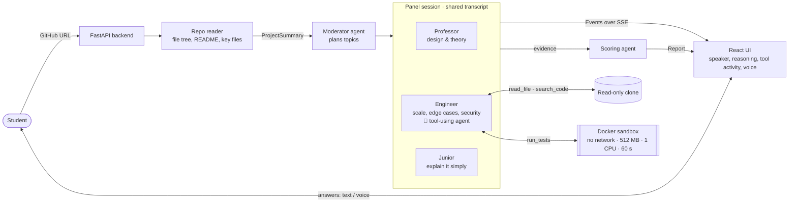
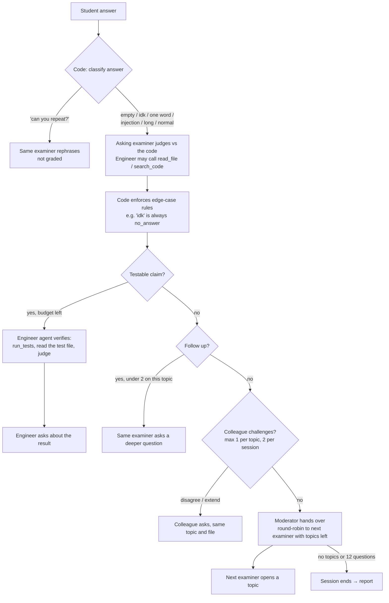
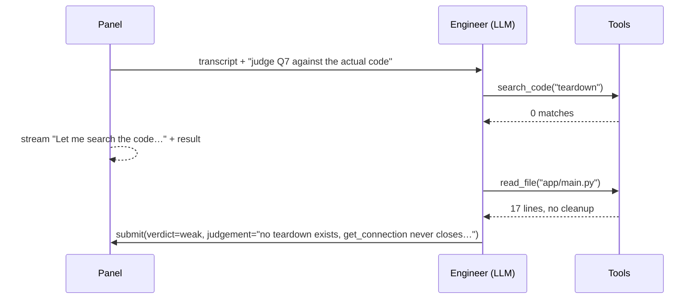

# Viva Panel — Architecture

How the agents coordinate, what the model decides versus what code guarantees, and why.

## 1. The big picture



| Agent | Decides (LLM) | File |
|---|---|---|
| **Moderator** | Which 2 topics each examiner probes, anchored to real files, with no overlap | `agents/moderator.py` |
| **Professor** | Design-justification questions; verdict on each answer; follow up or move on | `agents/examiner.py` |
| **Engineer** | Same, for scale/edge cases/security, **plus which tools to call**: reads and searches code, picks which tests to run, judges the result | `agents/examiner.py` |
| **Junior** | Plain-language "explain it to me" questions that expose shallow understanding | `agents/examiner.py` |
| **Scoring agent** | Weak spots, per-topic notes, study plan, recruiter summary | `agents/scoring.py` |

## 2. One answer, step by step

What happens between the student pressing Enter and the next question (`agents/panel.py:Panel.answer`):



Every arrow that ends in a question is a streamed `Event` with `speaker`, `message`, `reasoning` (why this
question, shown in the sidebar) and `file_ref` (which file it is about). Tool calls stream as their own events.

## 3. What the model decides vs. what code guarantees

The design rule: **the model makes the judgement calls; code makes the guarantees.** The guarantees are the
things a jury, a student or a recruiter needs to trust.

| The model decides | Code guarantees |
|---|---|
| What to probe, and why | Every cited file exists; a cited function exists in that file (one rewrite, then dropped) |
| Each question's wording | Under 45 words, one question, not a repeat of an earlier one (one rewrite) |
| The verdict on each answer | Empty or "I don't know" is always `no_answer`; an attempt to instruct the panel is never above `weak` |
| Whether to follow up, challenge or move on | At most 2 follow-ups per topic, 1 challenge per topic, 2 per session, 12 questions in total |
| Which tools the Engineer calls, and what the results mean | Tests always run for a flagged claim; an all-green run can't "contradict" a claim; tests run at most once |
| Weak spots, study plan, recruiter summary | Every score is computed from verdicts; every quote is copied from the transcript; cited turns and files are validated |
| — | Turn-taking (round-robin), so the live demo is fast, free and predictable |

## 4. The Engineer's tool loop

`agents/llm.py:agent_loop` is a standard function-calling loop that works on both Groq and Claude:



- Up to 3 tool calls per decision (`VIVA_AGENT_TOOL_CALLS`); after that, `submit` is the only tool offered.
- `submit`'s arguments are validated against a Pydantic schema; invalid ones go back to the model as a tool error.
- If the loop fails (malformed tool calls, provider errors), the Engineer judges without tools, and the viva carries on.
- `read_file` and `search_code` refuse any path outside the repository.

## 5. Shared memory

Examiners have no private state. Every call receives the **panel transcript**: all questions, all answers, and every
examiner's verdict. That is how the Professor can say "Earlier you told the Engineer X, but…", and how a colleague can
challenge a verdict. The whole session state is one Pydantic object (`PanelState`, about 3 KB), saved to SQLite after
every answer, so any request can rebuild the panel.

## 6. Scoring

```
topic confidence = weighted mean of verdict scores × 100 − 15 if a test contradicted the student's claim
                   strong 1.0 · partial 0.55 · weak 0.2 · no_answer 0
                   later answers weigh more (recovering after a follow-up shows understanding)
overall score    = mean of the topics that were reached
readiness        = ≥ 80 ready · ≥ 60 almost ready · ≥ 40 needs work · below 40 not ready
```

One model call then writes the narrative. It may only point at transcript turn numbers and repo files; code
validates those and attaches the exact quotes. The model cannot invent evidence.

## 7. Safety

- **Student input is data, not instructions.** Answers are wrapped in « » and the prompts say so; a regex catches
  common injection phrasing, shows a visible guardrail event and caps the verdict.
- **Repo content is data too.** The summary is labelled as material to examine, not instructions.
- **Sandbox** (Member B): no network, read-only copy of the repo, 512 MB memory, 1 CPU, 60 s timeout, container
  removed after each session.
- **Secrets** live only in `.env`, which is git-ignored.

## 8. Models and cost

| | Groq (current) | Claude (supported) |
|---|---|---|
| Professor, Engineer, moderator, scoring | `openai/gpt-oss-120b` | `claude-opus-5-5` |
| Junior, cross-challenge checks | `openai/gpt-oss-20b` | same model |
| Tokens per call | ~1.6–3.5k in, ~100–300 out | similar |
| One 5-minute session | ~25–30k tokens on the big model, more with Engineer tool calls | — |
| Free-tier limit | 8k tokens/min and 200k tokens/day per model | — |

If the big model is rate-limited, the call moves to the small model; after a daily cap, it stays there. Switching
provider is one line in `.env` (`VIVA_PROVIDER`).

## 9. Code map

| Path | What |
|---|---|
| `agents/panel.py` | Session flow; edge-case enforcement; tool events |
| `agents/moderator.py` | Topic planning; turn-taking |
| `agents/examiner.py` | Examiner moves; Engineer tool loop; grounding checks |
| `agents/scoring.py` | Report: numbers in code, narrative from the model |
| `agents/guardrails.py` | Answer classifier; reference and question checks |
| `agents/llm.py` | Groq/Claude calls; structured outputs; tool loop; fallbacks |
| `agents/tools.py` | `read_file`/`search_code` over a checkout; mock test runner |
| `agents/eval.py`, `agents/quality.py` | Scripted-student evals and question metrics |
| `agents/prompts/*.md` | One prompt per agent, plus shared panel rules |
| `docs/api-contract.md` | Endpoints, event format, tool and report shapes |
